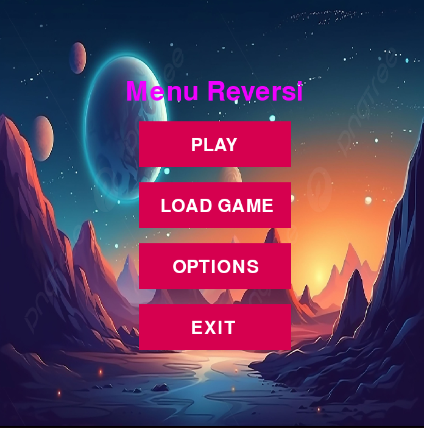
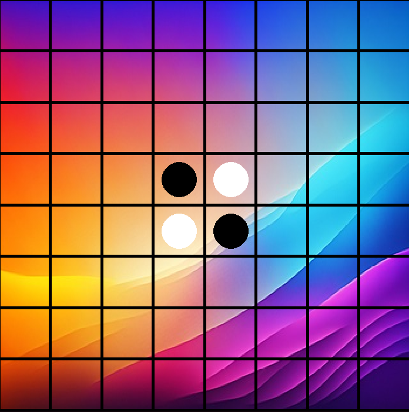
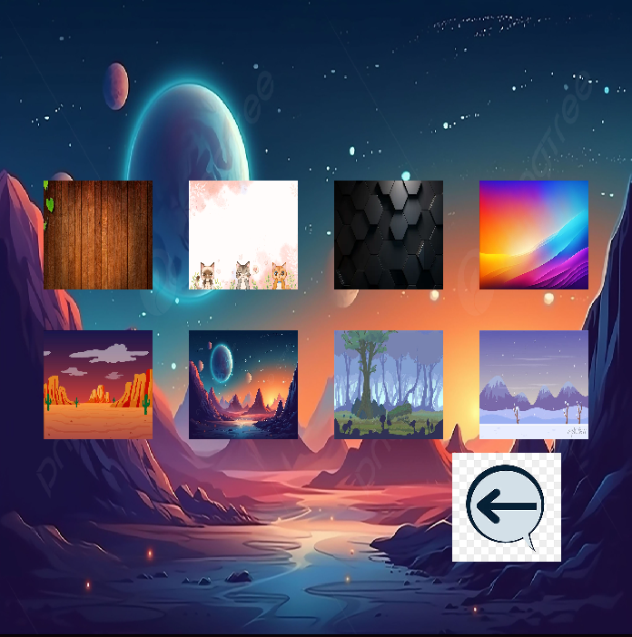

 # Reversi Game in Python



 ## Introduction

This project was developed as part of the coursework for the module "Introduction to Programming" at the University of Mindelo (UM) and CS50 Introduction to Programming with Python. It is a simple, educational implementation of Reversi (Othello) written in Python using Pygame. The code was written to practice event-driven programming, modular design, and basic game logic.

## About this implementation
This program implements a two-player local Reversi game on an 8×8 board. Players alternate placing black and white circular pieces. When a newly placed piece brackets one or more contiguous opponent pieces between it and another of the player's pieces, those opponent pieces are flipped to the player's color. The game ends when the board is full; the player with the most pieces wins.

## How to play

Requirements:

1. Python 3
2. Pygame (`pip install pygame`)

Run the game:

```bash
python3 project.py
```

Gameplay notes:
- The game starts at the menu. Use the options menu to change board background.
- Click a board cell to place a piece. Valid moves must flip at least one opponent piece.
- The game alternates piece creation using the pool in `data.py`; the UI draws pieces from that pool.

## Project structure and file responsibilities

- `project.py`: Program entry. Initializes Pygame, shows the menu, creates the piece pool, and forwards events to the renderer and game logic.
- `board.py`: Draws the 8×8 grid and calls `logic.generate_pieces()` to handle move placement and rendering of pieces.
- `data.py`: Builds and returns a list of `Piece` instances (64 total) and sets the four starting pieces in the center.
- `pieces.py`: `Piece` class with color, position, drawing surface, and a method to flip color (`is_color()`). Each piece draws itself as a filled circle.
- `logic.py`: Validates moves and implements flipping. The most important change was to scan in all eight directions, collect opponent pieces, and only flip when a bounding player's piece is found. This follows standard Reversi rules.
- `menu.py` / `options.py`: Simple UI for the main menu, background selection, and playing background music.
- `assets/variables.py`: Centralized constants (window size, colors, image paths, and `position` grid indices used to snap mouse clicks to cells).

## Design decisions and trade-offs

- Simplicity over optimization: data structures and algorithms are intentionally clear for learning rather than heavily optimized.
- Piece pool approach: I use a pre-created list of `Piece` objects (0–63) to simplify rendering and indexing. This keeps code approachable but could be refactored later to a board matrix for more direct lookups.
- Modularity: UI, data, pieces, and logic are separated so each file is small and easy to modify.

## Known issues and next steps

- The original flipping logic had edge cases; I updated the directional scanning and flipping behavior in `logic.py`. Please test corner/edge captures and long chains.
- Future improvements: add move highlighting (show legal moves), implement an AI opponent, add save/load, and write unit tests for the core flipping logic.

It's been years since I made this project. I learned Python at my Course of University and CS50 Introduction to Programming with Python, and after a long time I've returned to it in order to publish it as my final project to this online course.